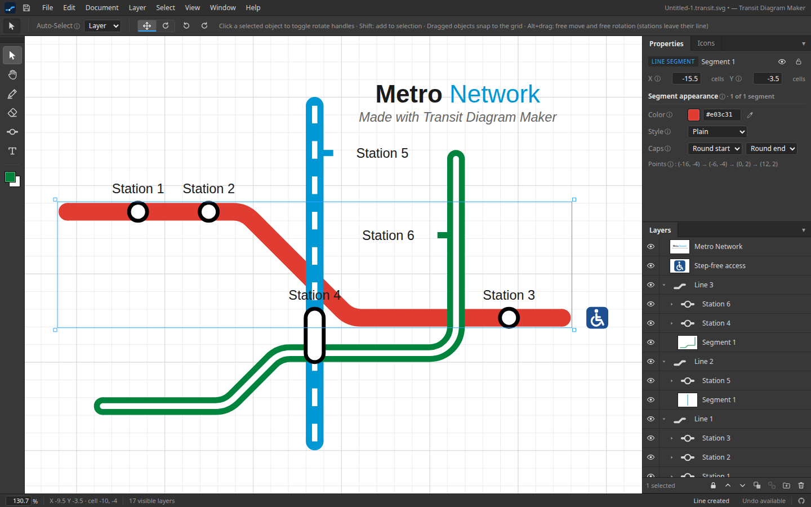
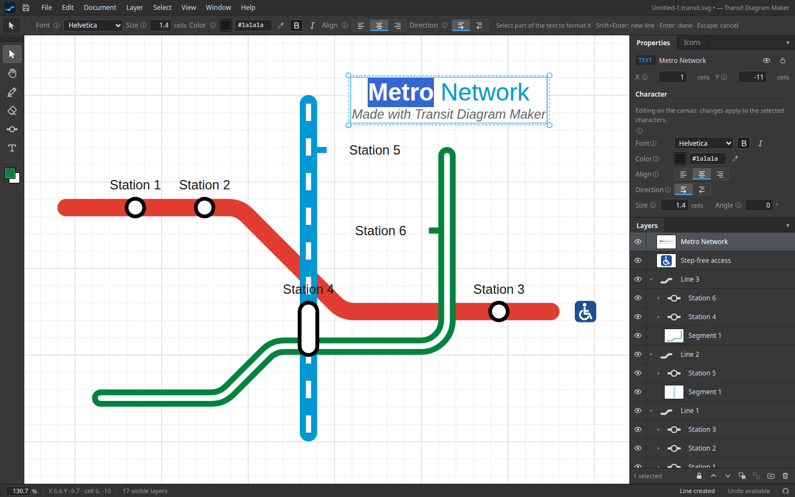
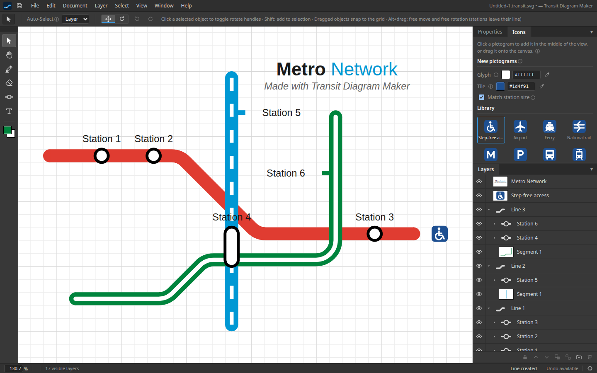
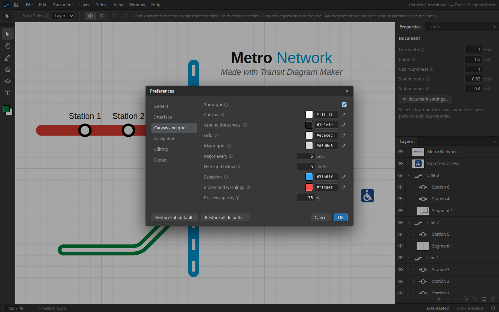
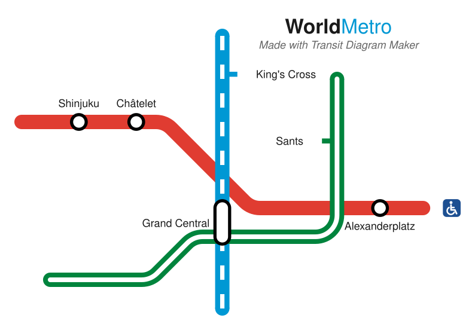

<h1 align="center">Transit Diagram Maker</h1>

<p align="center">
  <b>Draw clean, schematic metro maps in your browser.</b><br>
  A grid-based vector editor with a dark, Photoshop-style workspace: lines snap to 45° angles,
  stations snap onto their lines, and the result exports as a crisp SVG.
</p>

<p align="center">
  
</p>

<p align="center">
  <a href="#features">Features</a> ·
  <a href="#getting-started">Getting started</a> ·
  <a href="#using-the-editor">Using the editor</a> ·
  <a href="#how-it-works">How it works</a> ·
  <a href="#development">Development</a>
</p>

## Features

**Lines that stay schematic.** The line pen works on a square grid. Click the cells a line
passes through and it is routed with straight and 45° runs, with a smooth curve at every turn.
Lines can be plain, hollow (a channel of another color) or inner dashed (a solid line with
thin dashes down its middle, for example for a line under construction), and each segment of a
line can have its own style while the whole line shares one color. The erase tool cuts a line
into separate segments.

**Stations that know their line.** Dot, tick and pill stations snap onto the line they are
placed on and follow it when it moves. A pill can be painted across several parallel lines and
grown cell by cell. Every station gets a name label that stays next to it.

**Text like in a word processor.** Text boxes snap their corner to the grid. Select part of a
text to give it its own font, size, color, bold or italic, align every line on its own, and
write right to left for languages such as Hebrew and Arabic.

<p align="center">
  
</p>

**Pictograms.** Wheelchair access, airport, ferry, national rail, bus, tram and more, plus your
own SVG icons, all in the Icons panel: click one to add it, or drag it onto the map.

<p align="center">
  
</p>

**A real editor.** Layers and groups with visibility, locking and drag-and-drop ordering;
unlimited undo where a whole drag is one step; snapping that Alt turns off for free moves and
free rotation; an eyedropper on every color; rebindable keyboard shortcuts; and preferences for
just about every number in the program, each with a way back to the defaults.

<p align="center">
  
</p>

**Files you can open anywhere.** Maps are saved as `.transit.svg`: an ordinary SVG picture
(any browser or image viewer shows it) with the editor data embedded, so nothing is lost when
you open it again. Export a plain SVG at any scale for print or the web; it looks exactly
like the canvas. Here is the sample map above, exported:

<p align="center">
  
</p>

## Getting started

### Requirements

- [Rust](https://rustup.rs) (stable) with the `wasm32-unknown-unknown` target
- [wasm-pack](https://rustwasm.github.io/wasm-pack/installer/)
- [Node.js](https://nodejs.org) 20 or newer
- Google Chrome for the browser tests (optional)

### Install and run

```bash
rustup target add wasm32-unknown-unknown
cd web
npm install
npm run build:wasm   # compiles the Rust engine to WebAssembly (again after every Rust change)
npm run dev          # then open http://localhost:5173
```

On WSL with the repository on a Windows drive, start the dev server with
`VITE_POLL=1 npm run dev` so file changes are picked up.

`npm run build` produces a static site in `web/dist` that any web server can host.

## Using the editor

| Tool | Key | What it does |
| --- | --- | --- |
| Selection | `V` | Click, Shift+click or drag a marquee to select; drag to move. Click a selected object again for rotate handles. |
| Hand | `H` | Pan the view (or hold Space, or drag with the middle button). |
| Line pen | `P` | Click cells to add points; click the last point again or press Enter to finish. |
| Erase | `E` | Drag across a line to cut it into separate segments. |
| Station | `S` | Click a line for a dot or tick station; drag across lines for a pill. |
| Text | `T` | Click to place a text box, type, Shift+Enter for a new line, Enter to finish. |

- **Snapping:** everything snaps to the grid while you drag. Hold **Alt** to move in tenths of a
  cell and to rotate text and pictograms by any angle (stations then leave their line).
- **Formatting text:** double-click a text to edit it, select some characters and change the
  font, size, color, bold (`Ctrl+B`) or italic (`Ctrl+I`) in the options bar or the
  Properties panel. Alignment applies to the lines the selection touches.
- **Zoom and pan:** `Ctrl` + scroll zooms around the pointer, scroll pans, `Ctrl+0` fits the map
  on screen and `Ctrl+1` shows it at 100%.
- **History:** `Ctrl+Z` undoes and `Ctrl+Shift+Z` (or `Ctrl+Y`) redoes.
- **Shortcuts and preferences:** `F1` lists every shortcut, Edit ▸ Keyboard Shortcuts changes
  them, and Edit ▸ Preferences (`Ctrl+K`) holds the rest. Each preferences tab can return to its
  defaults, and Edit ▸ Restore All Defaults resets everything; Window ▸ Reset Workspace only
  brings back the panels.

Document settings (line width, curve radius, station sizes, label defaults) are saved in the
map and can be undone. Preferences, tool options and shortcuts belong to your browser.

## How it works

The editor is a Rust engine compiled to WebAssembly, with a Vue 3 + TypeScript interface on top.

- **The engine owns the document.** The model, geometry, undo history, rendering and file
  format live in Rust (`crates/transit-core`). The web app sends it commands and draws the SVG
  fragments it returns, so the canvas and the exported SVG come from the same code.
- **Everything is measured in grid cells.** A line is a list of turning cells, a station
  references the cells it covers and free positions use tenths of a cell; pixels only appear
  when rendering. That keeps maps topologically sound and lets an export pick any scale.
- **Every change is undoable.** Each edit snapshots the document before it runs, and drags,
  erase strokes and text edits are grouped into transactions, so one gesture is one undo step.
- **Files are SVG.** A `.transit.svg` file is the exported picture with every layer's data
  stored as attributes in its own XML namespace, plus the document settings and any uploaded
  fonts and icons. Uploaded SVG icons are sanitized before they are stored or drawn.

### Project layout

```
crates/
  transit-core/    document model, geometry, editor and history, SVG rendering, file format
  transit-wasm/    wasm-bindgen wrapper that exposes the engine to JavaScript (JSON in and out)
web/
  src/core/        typed bridge to the engine, rich text, viewport math, actions, shortcuts
  src/stores/      editor state, commands and preferences
  src/tools/       pointer and keyboard behavior of each tool
  src/components/  menu bar, options bar, tools, canvas, panels and dialogs
  tests/unit/      Vitest unit and component tests (with the real WebAssembly engine)
  tests/e2e/       Playwright browser tests and visual snapshots
docs/
  requirements.md  the specification
  images/          README screenshots (npm run screenshots)
```

## Development

```bash
cargo test                    # Rust tests (from the repository root)
cargo clippy --all-targets    # expected to be warning-free
cd web
npm test                      # unit and component tests
npm run typecheck
npx playwright test           # browser tests and visual snapshots (uses Google Chrome)
npm run screenshots           # regenerate the README screenshots in docs/images
```

Playwright uses the installed Google Chrome; set `PW_CHANNEL=chromium` to use its bundled
browser instead (`npx playwright install chromium`). After an intentional UI change, refresh
the visual baselines with `npx playwright test --update-snapshots`.

Branches: `main` holds releases and `dev` is the integration branch. New work goes on
`feature/*` and fixes on `bugfix/*`, both branched from `dev` and merged back with `--no-ff`.

## License

[MIT](Cargo.toml)
